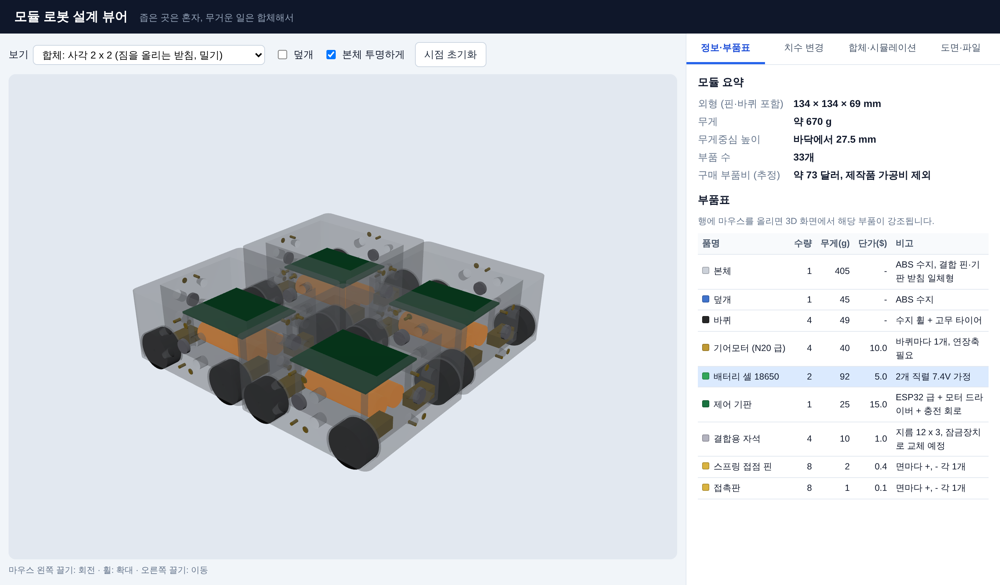
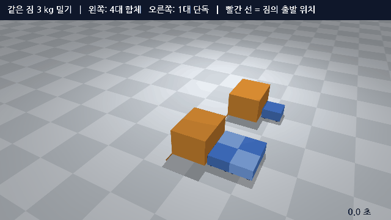

# robot-cad — 합체형 소형 모듈 로봇 설계

좁은 곳은 혼자, 힘이 필요하면 여러 대가 붙어서 일하는 손바닥 크기 로봇의 설계 저장소다.
부품을 파이썬 코드로 설계하고, 3D 파일·도면·부품표·시뮬레이션을 자동으로 만든다.
형상을 바꾸려면 `module1.py` 의 `Params` 숫자만 고치고 다시 실행하면 된다.



## 문서

| 문서 | 내용 |
|---|---|
| [docs/business-plan.md](docs/business-plan.md) | 사업계획서 초안 |
| [docs/research-notes.md](docs/research-notes.md) | 시장·경쟁사·지원사업 조사 메모 (출처 포함) |

## 결과물 (`out/`)

| 파일 | 내용 |
|---|---|
| `M1-001_body_drawing.pdf` / `.dxf` / `.svg` | 본체 제작 도면 (A3, 치수 포함) |
| `M1-000_assembly_drawing.pdf` / `.dxf` / `.svg` | 조립도와 부품표 |
| `module1.step` | 모듈 1대 3D 파일 (가공·3D 프린팅 업체 공유용 표준 형식) |
| `cluster_*.step` | 합체 형태 3D 파일: 일렬 4대, 사각 2×2, ㄴ자, 사각 3×3 |
| `module1_bom.csv` | 부품표 (무게, 추정 단가). 구글 스프레드시트에서 열림 |
| `clusters.csv` | 합체 형태별 크기·무게·미는 힘 |
| `sim_push.mp4` / `.gif` | 시뮬레이션 영상: 3 kg 짐을 1대와 4대가 각각 밀기 |
| `sim_results.json` | 시뮬레이션 수치 |
| `joint_loads.csv` | 결합부가 버텨야 하는 힘 |
| `*.glb` | 웹 뷰어용 3D 파일 |



## 웹 뷰어

저장소 최상위 폴더에서 실행한다.

```bash
npm install
```

```bash
npm start
```

브라우저에서 `http://localhost:3000/robot` 을 연다. 3D로 돌려 보기, 부품 강조, 합체 형태 보기,
도면 내려받기가 된다. '치수 변경' 탭은 파이썬 설계 코드를 실행하므로 아래 설치가 되어 있어야 한다.

## 설계 코드 실행

```bash
pip install -r robot-cad/requirements.txt
```

```bash
sh robot-cad/build_all.sh
```

| 파일 | 하는 일 |
|---|---|
| `module1.py` | 모듈 1대 설계. 부품 간섭과 결합 가능 여부를 자동 검사 |
| `clusters.py` | 합체 형태 생성, 결합면 간섭 검사, 미는 힘 단순 계산 |
| `drawing.py` | 치수 도면 생성 |
| `make_pdf.js` | 도면을 PDF 로 변환 (Playwright 필요) |
| `sim/push_sim.py` | MuJoCo 물리 시뮬레이션 |
| `joint_loads.py` | 결합부 요구 강도 계산 |

치수 몇 개만 바꿔서 따로 만들어 볼 수도 있다.

```bash
python robot-cad/module1.py --params '{"length": 150, "height": 70}' --out /tmp/test --no-drawings
```

## 모듈 1호 개념

- 본체 120 × 120 × 60 mm, 속이 빈 상자에 덮개. 무게 약 670 g
- 바퀴 4개는 본체 안쪽에 숨겨 옆면을 평평하게 유지 → 옆면 4곳 모두 결합 가능
- 결합부는 암수 구분이 없다. 밖에서 볼 때 왼쪽에 핀 2개, 오른쪽에 구멍 2개,
  가운데에 자석 자리, 위아래 줄에 전원 접점(+, -)
- 내부: 바퀴마다 소형 기어모터, 18650 배터리 2개, 제어 기판

## 아직 없는 것

- 결합부 잠금장치: 자석 자리만 있다. `joint_loads.csv` 기준 100 N 이상을 버텨야 하는 상황이 있어 기계식 잠금 설계가 필요하다.
- 구매 부품(모터·배터리·기판)은 규격품 대표 치수로 자리만 잡았다. 실제 제품을 정하면 치수를 고쳐야 한다.
- 도면의 공차는 일반공차 ±0.2 만 적었다. 끼워 맞춤 공차는 정하지 않았다.
- 무게와 단가는 추정값이다. 시뮬레이션의 마찰계수와 모터 힘은 가정값이다.
- 윗면·아랫면 결합이 없어 위로 쌓을 수 없다.
